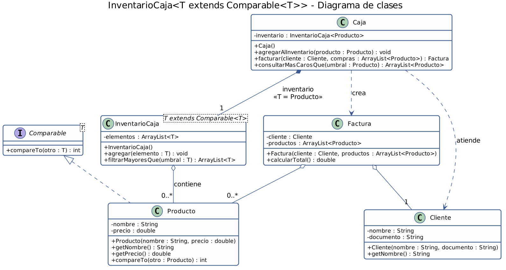

# Programación genérica en Java

Colección de ejercicios de **programación genérica** en Java, organizada en dos proyectos:

| Carpeta | Contenido |
|---|---|
| [`EjerGen`](#1-ejergen--los-9-ejercicios-de-programación-genérica) | Los 9 ejercicios de programación genérica, en un único archivo `Main.java`. |
| [`Enunciado`](#2-enunciado--inventariocajat-extends-comparablet) | Ejercicio de `InventarioCaja<T extends Comparable<T>>` con caja, cliente y factura. |

## Requisitos

- **OpenJDK 27** (probado con Temurin 27+35).
- IntelliJ IDEA o cualquier IDE con soporte para JDK 27 (opcional; también se puede usar la terminal).
- Los 9 ejercicios usan `record` y `var`, que requieren Java 16 o superior.

En IntelliJ, verifica que el SDK del proyecto sea el 27 en *File → Project Structure → Project*.

## Estructura

```
TodosEjer/
├── README.md
├── EjerGen/
│   └── Main.java                     ← los 9 ejercicios (clases anidadas + main)
└── Enunciado/
    ├── docs/
    │   ├── diagrama-uml.png          ← diagrama de clases
    │   └── diagrama-uml.puml         ← código fuente del diagrama
    └── src/main/java/uniquindio/edu/co/
        ├── Main.java                 ← pruebas del inventario
        └── model/
            ├── Caja.java
            ├── Cliente.java
            ├── Factura.java
            ├── InventarioCaja.java
            └── Producto.java
```

## Cómo ejecutar

**Desde IntelliJ:** abre la clase `Main` del proyecto que quieras probar y ejecútala con el botón *Run*.

**Desde la terminal:**

```bash
# EjerGen (9 ejercicios)
cd EjerGen
javac --release 27 Main.java
java Main
```

```bash
# Enunciado (InventarioCaja)
cd Enunciado/src/main/java
javac --release 27 -d out uniquindio/edu/co/Main.java uniquindio/edu/co/model/*.java
java -cp out uniquindio.edu.co.Main
```

---

## 1. EjerGen — Los 9 ejercicios de programación genérica

Todo está en un único archivo con una clase `Main`. Las clases e interfaces son estáticas anidadas, y `main` ejecuta una prueba por ejercicio.

En `Main.java`, cada ejercicio se ubica así:

- **Implementación:** sección `IMPLEMENTACIONES Y CLASES`, en el comentario `// N.`
- **Prueba:** método `probarEjercicioN()`, invocado desde `main`.

| # | Ejercicio | Clase / método | Concepto principal |
|---|---|---|---|
| 1 | Caja genérica | `Caja<T>` con `guardar(T)` y `obtener()` | Clase genérica básica |
| 2 | Mostrar un elemento | `<T> mostrarElemento(T)` | Método genérico estático |
| 3 | Contenedor genérico | `Contenedor<T>` y `ListaContenedor<T>` | Interfaz genérica e implementación |
| 4 | Intercambiar posiciones | `<T> intercambiar(T[], int, int)` | Método genérico sobre arreglos |
| 5 | Par de valores | `record Par<T>` con `sonIguales()` | Dos valores del mismo tipo |
| 6 | Caja numérica | `record CajaNumerica<T extends Number>` con `doble()` | Cota superior |
| 7 | Sumar | `<T extends Number> sumar(T, T)` → `double` | Cota superior en un método |
| 8 | Entidad persistente | `record EntidadPersistente<T extends Number & Comparable<T>>` | Cotas múltiples |
| 9 | Procesar | `<T extends Runnable & Comparable<T>> procesar(T, T)` | Cotas múltiples con interfaces |

### Notas

- `Par`, `CajaNumerica`, `EntidadPersistente` y `Tarea` son **records**: Java genera automáticamente el constructor, los métodos de acceso (`primero()`, `numero()`, `valor()`...), `equals`, `hashCode` y `toString`. Por eso al imprimir un par se ve `Par[primero=java, segundo=java]`.
- En las cotas múltiples (ejercicios 8 y 9) la clase va primero (`Number`) y las interfaces después (`& Comparable<T>`).
- Ninguna clase estándar común es `Runnable` y `Comparable` a la vez, así que el ejercicio 9 usa el record de apoyo `Tarea`.
- Al final de `Main.java` hay una guía con la misma información de la tabla y una nota por ejercicio.

### Ejemplo de salida

```
--- Ejercicio 4: intercambiar ---
Antes:   [1, 2, 3, 4, 5]
Después: [5, 2, 3, 4, 1]

--- Ejercicio 7: sumar<T extends Number> ---
sumar(3, 4)        = 7.0
sumar(2.5, 1.25)   = 3.75
sumar(10L, 5L)     = 15.0

--- Ejercicio 9: procesar<T extends Runnable & Comparable<T>> ---
  Ejecutando tarea 'Enviar reporte' (prioridad 1)
Resultado de comparar (baja vs alta): -1
```

---

## 2. Enunciado — `InventarioCaja<T extends Comparable<T>>`

### Enunciado

> Diseñar una clase genérica `InventarioCaja<T extends Comparable<T>>` que almacene elementos en una `ArrayList<T>`. Implementar un método que, usando únicamente un `Iterator`, devuelva una nueva lista con los elementos mayores que un valor dado `T umbral`. Se prohíbe el uso de `for-each` y `streams`.

Para darle contexto, el ejercicio se modeló como una caja registradora con su inventario, sus clientes y sus facturas.

### Arquitectura



El código fuente del diagrama está en [`Enunciado/docs/diagrama-uml.puml`](Enunciado/docs/diagrama-uml.puml) (PlantUML), por si quieres editarlo.

### Clases

Las cinco clases están en el paquete `uniquindio.edu.co.model`, y `Main` está en `uniquindio.edu.co`.

| Clase | Responsabilidad |
|---|---|
| `Producto` | Elemento del inventario, con nombre y precio. Es `Comparable<Producto>` y se compara por precio. |
| `InventarioCaja<T>` | **Clase del ejercicio.** Guarda los elementos en un `ArrayList<T>` y filtra con `Iterator`. |
| `Cliente` | Persona que realiza la compra (nombre y documento). |
| `Factura` | Relaciona un `Cliente` con los productos comprados y calcula el total. |
| `Caja` | Clase central: tiene el inventario, factura compras y consulta los productos más caros. |
| `Main` | Pruebas: `InventarioCaja` con `Integer` y `String`, flujo completo de la caja y validación de nulos. |

### Cómo funciona `filtrarMayoresQue(T umbral)`

1. Crea una lista nueva y vacía (`resultado`).
2. Obtiene un `Iterator<T>` del `ArrayList` interno.
3. Con `while (it.hasNext())`, llama a `next()` una sola vez por vuelta y guarda el elemento en una variable local.
4. Si `actual.compareTo(umbral) > 0`, lo agrega al resultado. Los elementos **iguales** al umbral no entran, porque el enunciado dice "mayores".
5. Devuelve el resultado. El inventario original no se modifica.

Complejidad: O(n) en tiempo y O(k) de espacio adicional, donde k es la cantidad de elementos que superan el umbral.

### Decisiones de diseño

- `agregar(null)` y `filtrarMayoresQue(null)` lanzan `IllegalArgumentException`.
- `Caja.consultarMasCarosQue` recibe un `Producto` de referencia como umbral; de él solo importa el precio.
- `Caja.facturar` genera la factura pero no descuenta productos del inventario.
- No hay `for-each` ni `streams` en ninguna clase. `Factura.calcularTotal()` y el método que imprime productos en `Main` también recorren con `Iterator`.

### Ejemplo de salida

```
--- Prueba 1: InventarioCaja<T> con Integer y String ---
Enteros mayores que 10: [12, 20, 12]
Enteros mayores que 12 (el igual no entra): [20]
Enteros mayores que 100: []
Palabras mayores que "mango": [manzana, uva, pera]

--- Prueba 2: Caja, Cliente y Factura ---
Productos más caros que $12500 (el igual no entra):
  - Aceite ($15000.0)
  - Carne ($28000.0)
Factura de Ana Gómez -> total: $23000.0

--- Prueba 3: valores nulos ---
agregar(null) rechazado: El elemento no puede ser nulo
filtrarMayoresQue(null) rechazado: El umbral no puede ser nulo
```
